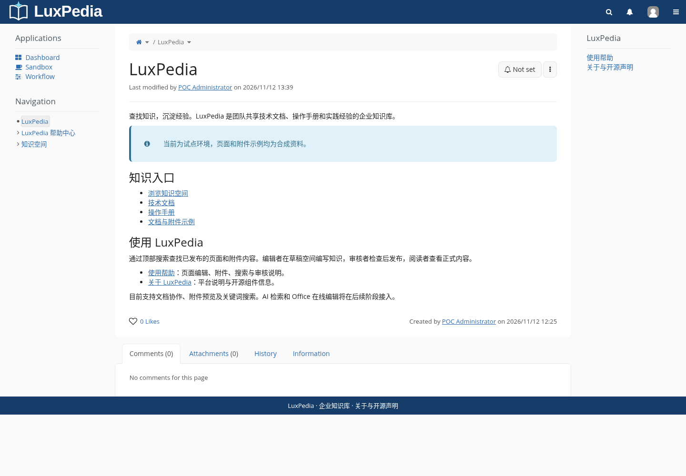

# LuxPedia：企业知识库 POC

基于 [h3mxxx/manu-wiki](https://github.com/h3mxxx/manu-wiki) 空仓库建立。优先官方、开源、免费组件；不采购、不操作生产、不迁移 BWIpedia 全量数据。

当前隔离环境已安装 **XWiki Standard 17.10.15 LTS + PostgreSQL 16.15 + Publication Workflow 2.4.9**，配置示例知识、账号权限及模板。AI 与 Office 后续方案已整理；根据用户最新选择，先完成核心 Wiki，不部署模型。

用户界面采用 **LuxPedia** 品牌，仓库仍名为 `manu-wiki`。品牌配置使用官方主题和 Skin 机制，详见[应用及回退说明](docs/branding.md)。新部署不会自动应用实例中的品牌与首页。

访问地址：`http://127.0.0.1:8080/`，**仅在当前云环境内可达**，不是用户电脑的 localhost，也没有公网/企业长期入口。当前共享 Desktop 浏览器工具不可用，已用环境内 Chromium 完成实际浏览器验收。管理员账号和密码保存在本地 `.secrets/admin_username`、`.secrets/admin_password`；不要提交到 Git。

## 启动

普通非生产服务器，先确认没有待复用服务，再执行：

```bash
./scripts/init.sh
docker compose up -d
docker compose ps
```

首次访问按官方向导创建管理员并安装与运行时相同版本的 XWiki Standard。初始化不会覆盖已有数据库密码。示例内容在 `examples/pages/`，合成验收附件在 `examples/attachments/`；新部署的账号/权限/模板按使用文档配置，不会因 `up` 自动导入。

当前云环境已经生成代理及 CA 配置，后续使用：

```bash
export COMPOSE_FILE=compose.yaml:compose.cloud.yaml
docker compose up -d
python3 tests/smoke.py
./scripts/backup.sh
```

不要运行 `docker compose down -v` 或清理数据卷。云环境寿命不代表长期持久化，迁移/恢复方法见部署说明。

## 交付与记录

- [部署、启动、备份和恢复](docs/deployment.md)
- [账号、权限、编辑、附件和模板](docs/usage.md)
- [Publication Workflow 配置与实际记录](docs/workflow.md)
- [AI 版本、模型接口、索引与权限方案](docs/ai.md)
- [Office 引擎和连接器源码构建调研](docs/office.md)
- [组件、版本、许可证与费用](docs/components.md)
- [安装过程中的问题及离线备用方案](docs/installation-notes.md)
- [验收结果](reports/acceptance.md) · [阶段进度与问题清单](reports/status.md)
- [基础版本运行测试](reports/baseline-test-2026-11-12.md) · [变更记录](CHANGELOG.md) · [版本发布流程](docs/releasing.md)
- [LuxPedia 品牌配置](docs/branding.md) · [品牌验收](reports/branding-acceptance.md)

`tests/smoke.py` 是针对本实例合成数据的只读检查，需要本地测试账号密码文件；它不创建账号，也不能代替人工浏览器验收。真实模型问答、语义检索、AI 权限隔离和 Office 保存回写均未验收。


